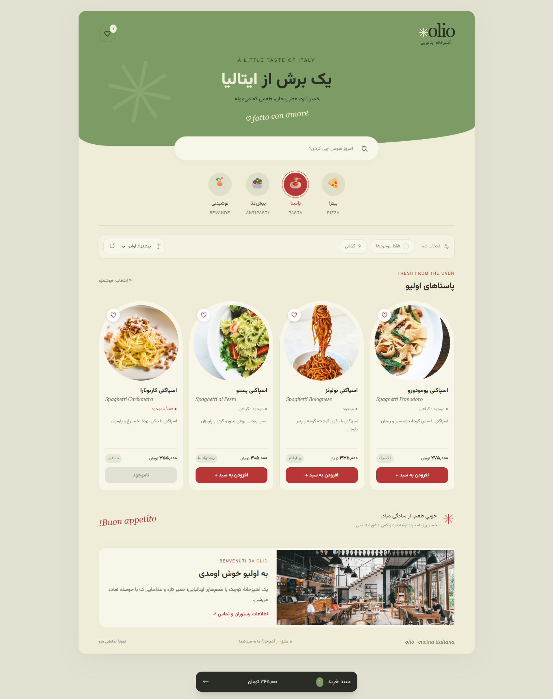

# Olio Menu | منوی ایتالیایی اولیو

یک منوی دیجیتال فارسی و راست‌به‌چپ برای رستوران ایتالیایی، با طراحی واکنش‌گرا، جست‌وجو و فیلتر محصولات، علاقه‌مندی‌ها و سبد خرید.

ساخته‌شده با **HTML5، Tailwind CSS 4 و Vanilla JavaScript**، همراه با CSS اختصاصی برای جزئیات طراحی.

## پیش‌نمایش



## امکانات

- چهار دستهٔ فعال: پیتزا، پاستا، پیش‌غذا و نوشیدنی
- نمایش تصویر، توضیحات، قیمت و وضعیت موجودی محصولات
- جست‌وجو با اینتر یا دکمهٔ جست‌وجو در تمام دسته‌ها
- فیلتر محصولات موجود و گیاهی، و مرتب‌سازی بر اساس قیمت
- نمایش جزئیات محصول در مودال
- لایک و نمایش علاقه‌مندی‌ها
- افزودن، حذف و تغییر تعداد محصولات، هم در کارت و هم در سبد خرید
- محاسبهٔ خودکار مبلغ و نمایش خلاصهٔ خرید
- ذخیرهٔ سبد خرید و علاقه‌مندی‌ها در مرورگر با localStorage
- نمایش اطلاعات و تصاویر نمونهٔ رستوران
- انیمیشن‌های ملایم با رعایت تنظیم کاهش حرکت مرورگر

## اجرا
فایل `dist/index.html` را باز کنید، یا پوشهٔ `dist` را با Live Server اجرا کنید. CSS کامپایل‌شده و تصاویر همراه پروژه هستند. فونت گوگل به اینترنت نیاز دارد و Tahoma جایگزین آن است.

## ویرایش
- `dist/index.html`: ساختار صفحه و اطلاعات نمونهٔ رستوران.
- `dist/data.js`: محصولات، قیمت به تومان، موجودی، دسته، مواد حساسیت‌زا و تصاویر.
- `dist/script.js`: سرچ با اینتر/ذره‌بین، فیلتر، مودال، لایک و سبد خرید.
- `src/input.css`: ورودی Tailwind، تم رنگی و CSS اختصاصی انحناها.
- `dist/style.css`: خروجی تولیدشده؛ آن را مستقیم ویرایش نکنید.
- `dist/assets`: تصاویر نمونه از Unsplash.

برای ویرایش استایل‌ها، ابتدا Node.js و npm را نصب کنید. سپس در ریشهٔ پروژه یک بار `npm ci` را اجرا کنید و بعد از تغییر کلاس‌های HTML/JS یا CSS، خروجی را بسازید:

```sh
npm ci
npm run build:css
```

برای تغییر متن‌ها و دادهٔ محصولات نیازی به build مجدد نیست، مگر کلاس Tailwind جدیدی اضافه کرده باشید.

## رفتار نمونه
هر چهار دسته فعال‌اند. سرچ پس از اینتر یا ذره‌بین بین تمام دسته‌ها انجام می‌شود؛ فیلتر موجودی، گیاهی و ترتیب قیمت با هم کار می‌کنند. سبد و علاقه‌مندی‌ها در localStorage همان مرورگر ذخیره می‌شوند. تعداد سبد از موجودی نمونه بیشتر نمی‌شود. قیمت‌ها بر حسب تومان‌اند و هزینهٔ اضافه صفر است.

این پروژه فرانت‌اند نمایشی است: موجودی و اطلاعات رستوران نمونه‌اند، بک‌اند، پرداخت یا ارسال سفارش ندارد. شماره تلفن و ایمیل با اطلاعات واقعی جایگزین شوند. کنترل موجودی واقعی باید سمت سرور هم انجام شود.
